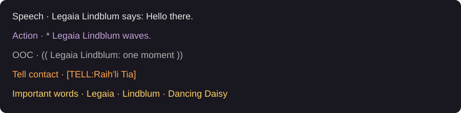
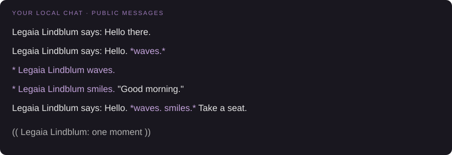
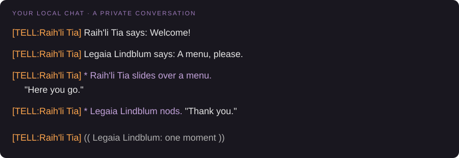

# ReflavorRP: your first roleplay session


This guide uses **Legaia Lindblum** as your character and **Raih'li Tia** as your conversation partner. Replace those names and the example world with real ones when sending a Tell.

## 1. Set up your chat

Follow the [installation instructions](README.md#installing), then open `/reflavor`.

| Tab | Setting | What it does |
| --- | --- | --- |
| Outgoing | Conversion enabled | Formats messages you send. |
| Outgoing | Replace the /me emote | Makes `/me` write an action instead of playing the game's emote animation. |
| Incoming | GTA World style chat | Restyles Say, custom emotes, eligible Shout/Yell and both directions of Tell. |
| Incoming | Darker text for distant players | Dims nearby players' Say and emote lines according to distance. |
| Accents | Active accents | Applies selected speech transformations in order. Leave empty to start without an accent. |

**Enable Echo in your chat tab's filters.** Restyled messages appear as local Echo lines, including Tells. Nothing is sent to other players by incoming styling.

**Other chat plugins are incompatible**, including Chat 2 and ChatProximity. Do not combine them with ReflavorRP.

## 2. Read the colors



| Color | Meaning |
| --- | --- |
| Light grey `#E6E6E6` | Spoken dialogue. |
| Purple `#C2A2DA` | Actions and narration. |
| Grey `#AFAFAF` | Out of character, or OOC. |
| Orange `#FFA64D` | The Tell contact prefix. |

The previews below illustrate text and colors against a dark background. They do not reproduce the game's exact font, timestamps or UI. Names in images are static; eligible names in game retain their native player links.

## 3. Speak, act, or combine both

Use `/say` for dialogue, `/me` for actions, and `*asterisks*` for actions inside a spoken message. For dialogue inside an emote, use straight double quotes.

| Case | Type this | FFXIV command sent |
| --- | --- | --- |
| Simple dialogue | `/say hello there` | `/say "Hello there."` |
| Dialogue with an action | `/say hello *waves*` | `/say "Hello." waves.` |
| Action only | `/me waves` | `/em waves.` |
| Action with dialogue | `/me smiles. "good morning"` | `/em smiles. "Good morning."` |
| Action written with asterisks | `/say *waves*` | `/em waves.` |
| Several actions between dialogue | `/say hello *waves* *smiles* take a seat` | `/say "Hello." waves. smiles. "Take a seat."` |
| OOC | `/b one moment` | `/say (( one moment ))` |

With incoming styling enabled, those messages look like this:



The game adds your character's name to native `/em` messages. **Write `/me waves`, without adding your own name.** `/em` and `/ame` also work; `/me` requires its replacement setting to be enabled.

With the Say channel active, you can type `hello there` without `/say`. Bare text in other active channels is left alone. For consistent formatting in another channel, use its explicit prefix as shown below.

### Why did someone's message become OOC?

Incoming Say without quotes or marked actions is treated as OOC. For example, a received Say body of `brb` becomes `(( Raih'li Tia: brb ))`.

Your outgoing `/say brb` becomes quoted speech automatically. Use `/b brb` when you mean OOC. Plain incoming Tell is treated as speech; use `(( ... ))` for OOC there.

## 4. Shout or whisper as part of a scene

| Type this | FFXIV command sent |
| --- | --- |
| `/s help me` | `/em shouts, "Help me!"` |
| `/s *slams the table* stop` | `/em slams the table. Shouts, "Stop!"` |
| `/low come here` | `/em whispers, "Come here."` |
| `/w Rai did you hear that?` | `/em whispers to Rai, "Did you hear that?"` |

**`/low` and `/w` describe a whisper in a local emote. They do not send a private message.** Use `/tell` for privacy.

Likewise, ReflavorRP's `/s` describes shouting through `/em`; it does not send to the Shout channel. This overrides FFXIV's usual `/s` shorthand for Say while conversion is enabled.

The generated words `shouts`, `whispers` and `whispers to` can be changed under **Outgoing → Verbs**.

Actual incoming Shout/Yell uses a `Name shouts:` header, with actions in purple, when the sender is loaded nearby and has the Role-playing status. Other Shout/Yell messages keep their native appearance.

## 5. Have a private conversation with Tell

Put the recipient before your message or RP command:

```text
/tell Raih'li Tia@Balmung hello
/tell Raih'li Tia@Balmung /me waves
/tell Raih'li Tia@Balmung hello! *She coughs*
/tell Raih'li Tia@Balmung /b one moment
```

The first sends `"Hello."`. The second sends `Legaia Lindblum waves.`. The third sends `"Hello!" She coughs.`. The last sends `(( one moment ))`. All four stay in Tell.

### Follow the contact and the author

The orange `[TELL:Raih'li Tia]` identifies the **contact**, in both directions. The name after it identifies **who spoke**:



The illustrated conversation uses these message bodies:

| Direction | Body sent or received |
| --- | --- |
| Incoming from Raih'li | `"Welcome!"` |
| Outgoing from you | `"A menu, please."` |
| Incoming emote | `Raih'li Tia slides over a menu. "Here you go."` |
| Outgoing emote | `Legaia Lindblum nods. "Thank you."` |
| Outgoing OOC | `(( one moment ))` |

For the outgoing emote, type `/tell Raih'li Tia@Balmung /me nods. "thank you"`; the formatter supplies your name.

Tell narration must already contain a name when one is needed. Incoming styling never invents an author inside an emote: a received `*waves*` becomes `[TELL:Raih'li Tia] * waves`, not `* Raih'li Tia waves`.

The contact remains clickable when the original message supplies a native player link. A name merely written in narration is ordinary text. The visible world suffix is removed from linked display names.

### Reply quickly

```text
/reply thank you
/reply /me nods
/reply /b back in a minute
```

`/r` is an alias for `/reply`. FFXIV chooses the reply recipient normally.

## 6. Use Party, linkshells and other channels

Put the channel first. The RP command formats the body while the channel prefix keeps its destination.

| Type this | Sent as |
| --- | --- |
| `/party /me waves` | `/party Legaia Lindblum waves.` |
| `/party hello everyone` | `/party "Hello everyone."` |
| `/l1 /say on my way` | `/l1 "On my way."` |
| `/cwl1 /b five minutes` | `/cwl1 (( five minutes ))` |
| `/fc /me raises a glass` | `/fc Legaia Lindblum raises a glass.` |
| `/alliance /say ready` | `/alliance "Ready."` |

Supported routes include Party (`/party`, `/p`), Tell (`/tell`, `/t`), Reply (`/reply`, `/r`), Free Company (`/freecompany`, `/fc`), Alliance (`/alliance`, `/a`), linkshells (`/linkshell`, `/l`) and cross-world linkshells (`/cwlinkshell`, `/cwl`), including numbered linkshells 1–8.

These channels have no native custom-emote layout, so routed actions include your character's name in the message body. Incoming Party, FC, Alliance and linkshell messages keep their native appearance; they do not receive the public-chat styling shown above.

**Selecting Party and then typing a bare `/me` does not route the emote to Party.** Use `/party /me ...` explicitly. A channel command without a body is left alone so you can still select channels normally.

## 7. Try an accent

Open **Accents**, select a template under **Active accents**, and type in the preview field before sending anything.

For example, **Uwufication** changes spoken `"Sorry, I really love this nice place."` to `"Sowwy, I weawwy wuv this nyice pwace."`.

Accents affect speech, including quoted dialogue inside `/me`. They leave actions, narration and `/b` unchanged. You can combine accents in order, remove an active accent, or use **Copy active accent** to make an editable copy of a template.

## 8. Understand distance and messages kept unchanged

With distance fading enabled, Say and custom emotes from loaded players get darker as they move away:

| Distance | Brightness |
| --- | --- |
| Under 4 yalms | 100% |
| 4 to under 8 | 87% |
| 8 to under 12 | 74% |
| 12 to under 16 | 61% |
| 16 or more | 48% |

Your own lines remain at full brightness. Tell, Shout and Yell never fade. Players who cannot be found among the loaded characters are not distance-faded.

Messages containing item links, map links or auto-translate are kept in their native format to preserve those features. This is expected.

## Quick fixes

| What happened? | What to check |
| --- | --- |
| Styled messages disappeared | Enable Echo in the current chat tab. |
| A Tell appears in an unexpected tab | Restyled Tells are local Echo lines; the tab's Echo filter controls visibility. |
| `/me` played an animation | Enable **Replace the /me emote**. |
| A whisper was visible to nearby players | `/low` and `/w` are local narration. Use `/tell` for private messages. |
| Party or linkshell text was not converted | Include the channel prefix in the message, such as `/party /me waves`. |
| A Say message became grey OOC | Incoming unquoted Say with no marked action is treated as OOC. Use quotes for dialogue. |
| A linked message was not restyled | Unsupported payloads keep their native appearance. |
| A split post has speech and actions swapped | Unmatched straight quotes are ambiguous. Closing curly quotes (`”`) can identify a continuation that starts in speech. |

For settings, installation and technical details, see the [README](README.md).
