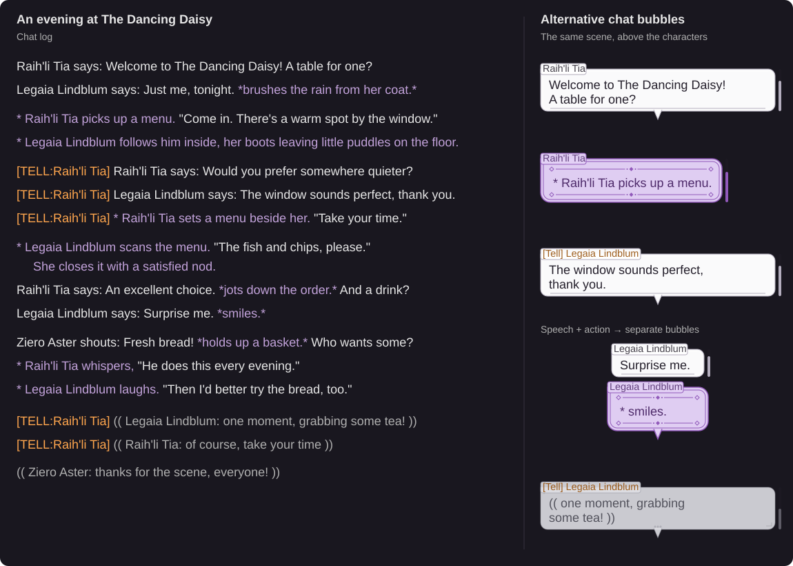

# 

## About
A [Dalamud](https://github.com/goatcorp/Dalamud) plugin for FINAL FANTASY XIV that brings SA-MP / GTA World style roleplay to your chat. Write dialogue and actions with familiar commands, style incoming conversations, and add optional speech accents. Other players see normal FFXIV messages; the restyling is local to you.

## Example


The chat log is on the left; examples of the plugin's alternative chat bubbles are on the right. Enable **Incoming → Alternative chat bubbles** in `/reflavor` to use them. Mixed speech and actions appear in separate bubbles.


# How to Use it
**Start with the [illustrated user guide](GUIDE.md)** for setup, commands, Tell conversations, channels and examples. Open `/reflavor` in game to configure the plugin.

**Incompatible with other chat plugins, including Chat 2 and ChatProximity.** Enable **Echo** in your chat tab to see restyled messages.

## Installing

ReflavorRP isn't in the official plugin list, so it's installed from a custom repository:

1. In game, open `/xlsettings` → **Experimental**.
2. Under **Custom Plugin Repositories**, add this URL, tick **Enabled** and save:
   ```
   https://raw.githubusercontent.com/Day-OS/ffxiv-reflavor-rp/master/repo.json
   ```
3. Open `/xlplugins`, search for **ReflavorRP** and install it.

## Releasing

Push a version tag and the [release workflow](.github/workflows/release.yml) does the rest:

```
git tag v0.1.0
git push origin v0.1.0
```

It builds the plugin with that version, creates a GitHub release with `latest.zip`, and updates `repo.json` on `master` so installed copies pick up the update.

## Building

You need XIVLauncher with Dalamud (run the game with it at least once) and the .NET 10 SDK.

1. Open `ReflavorRP.slnx` in Visual Studio, Rider or VS Code, or run `dotnet build` in the repo folder.
2. The plugin ends up in `ReflavorRP/bin/x64/Debug/ReflavorRP.dll`.
3. In game, open `/xlsettings` → **Experimental** and add the full path to that DLL under **Dev Plugin Locations**.
4. Open `/xlplugins` → **Dev Tools** → **Installed Dev Plugins** and enable ReflavorRP.

Watch out for the output folder: building with the `x64` platform writes to `bin/x64/Debug`, building as `Any CPU` writes to `bin/Debug`. Point Dalamud at the one your IDE actually builds, or rebuilds won't show up in game.

## Chat styling test previews

Run the chat examples with detailed output to see the original message and a readable preview of the styled result:

```powershell
dotnet test ReflavorRP.Tests/ReflavorRP.Tests.csproj --filter FullyQualifiedName~ChatStylerTests.FormatsChat --logger "console;verbosity=detailed"
```

The tests check the actual text and encoded colors using Dalamud/Lumina. The preview is the actual printed `[TELL:Contact] Author says: message` or `[TELL:Contact] * Author action.` line. It does not render the game UI. Speech is `#E6E6E6`, and emotes/narration are `#C2A2DA`.

## A personal project, made with AI assistance

I made ReflavorRP for fun and for my own use. It's a simple personal project, built with AI assistance, and I'm sharing it in case someone else finds it useful.

The Markdown documentation and tests are AI-generated. The plugin code was developed with AI assistance and human review, with implementation decisions evaluated by me. If any of this bothers you in anyway, you are free to create your own plugin in any shape or form you desire... if you want... I guess?

To keep this hobby project manageable and avoid the headaches of handling support requests and contributions, I've blocked issues and pull requests. I want to keep working on it at my own pace, without turning it into another obligation.

## Credits and license

The project skeleton (project file, build setup, plugin entry point layout) started from goatcorp's [SamplePlugin](https://github.com/goatcorp/SamplePlugin) template. The chat conversion, chat styling and accent code is ReflavorRP's own.

Licensed under the [Mozilla Public License 2.0](LICENSE.md).
